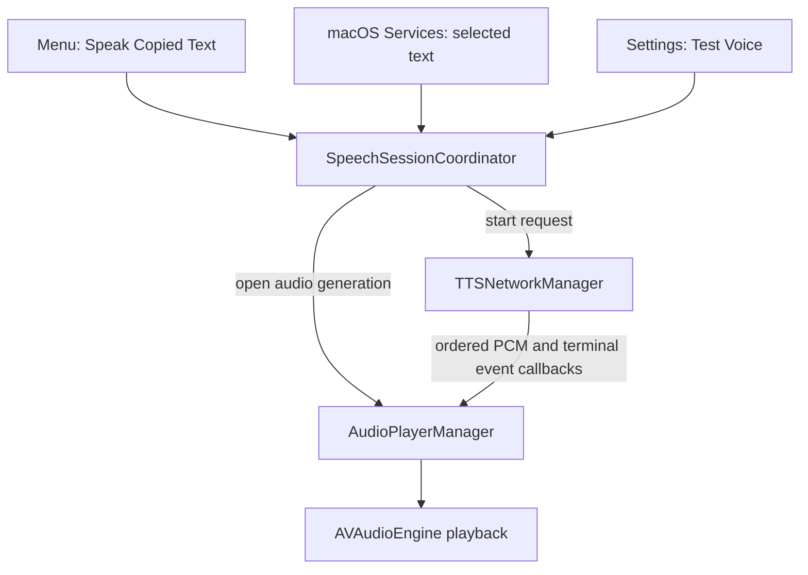

# Clipboard TTS Design

This document owns the product requirements, the app's current architecture, design assumptions, test-harness design, and the user's accepted decisions. [README](README.md) owns installation, build, test, and operating procedures. Where a rule names a declaration, that declaration's doc comment carries the detailed reasoning; `Dnn` points to [Accepted Decisions](#accepted-decisions), and task IDs point to the records in [tasks/](tasks/).

## Product Requirements

Clipboard TTS is an improved macOS text-to-speech service. This section owns the user-visible behavior.

### App Appearance

- The app should reside in the menu bar, with a macOS native look and feel (built using Native Swift/SwiftUI).
- Clicking on the app button in the menu bar should open a drop-down menu with the following options:
    - Speak Copied Text/Clear Buffer
    - A progress slider representing the currently buffered audio. Its maximum length grows as more audio arrives dynamically.
    - Pause/Resume
    - Playback Speed, adjusted with a continuous slider from 0.5x to 2.5x (0.1x increments)
    - Settings (Model Selection, Voice Selection, API Key, Local/Online API Base URL, Test Voice, About, etc.). The provider list is a left sidebar with About below it, and the configuration pane fills the window at any window size.
- Voice selection lives only in Settings, alongside the model and API key it belongs with. The drop-down is for playback control; it neither offers nor displays the configured voice.
- The menu bar icon is a fixed `waveform.circle` and does not reflect playback state. The stateful-icon requirement was withdrawn on 2026-08-03 and is not planned.

### Starting Playback

- The user should be able to select text in any application and right-click -> Services -> click "Speak Selected Text with Clipboard TTS" to send to TTS engine for playback. Note that Services is not available in all applications, so there is also the next item.
- The user should be able to copy text in any application and click "Speak Copied Text" from the menu bar app to send to TTS engine for playback.
- The app should start streaming audio within 2 seconds after the user clicks the button.
- When OpenAI is the selected provider and the copied text is longer than the 4,096 characters the app sends OpenAI in one request, the click starts no request and shows a pop-up naming that maximum and how long the copied text is, so the user learns what is wrong instead of waiting for a generic failure. Text within the limit, Gemini and Custom requests, the Services entry point, and Settings' Test Voice are unaffected.
- While audio is streaming or buffered, the "Speak Copied Text" button becomes "Clear Buffer": clicking it stops playback and discards the buffer. Speaking new text is a second click of "Speak Copied Text" — the app deliberately does not interrupt-and-replace in one click.

### Control and Navigation During Playback

- The user should be able to pause and resume the currently playing audio from the menu bar.
- The user should be able to stop playback entirely from the menu bar to cancel a read and discard content that has yet to be sent to the TTS engine.
- The user should be able to change the playback speed anywhere from 0.5x to 2.5x (continuous slider, 0.1x increments) during playback.
- The user should be able to drag the slider thumb to jump to a precise point in the buffered audio.

## Architecture Overview

The menu, macOS Services, and Settings' Test Voice each prepare text under their own entry-point rules. All three call [SpeechSessionCoordinator](Sources/Managers/SpeechSessionCoordinator.swift), which starts the audio generation and connects the network request's callbacks to it. The network manager delivers PCM and a terminal event; the audio manager buffers and plays that PCM.



The coordinator binds each callback to the audio generation it started. Request and audio generations independently reject work from a replaced session. Cancellation revokes the request before clearing its audio; a normal terminal event follows accepted PCM and lets playback distinguish completion from a temporary underrun.

| Responsibility | Owner and confinement |
|---|---|
| Entry-point UI and session sequencing | `SpeechSessionCoordinator` runs on main; SwiftUI, AppKit, and Services UI work is handed to main. |
| Request settings, parsing, and generation | [TTSNetworkManager.stateQueue](Sources/Managers/TTSNetworkManager.swift) serializes mutable request state. |
| Callback authorization and revocation | [RecursiveCallbackAuthority](Sources/Managers/CallbackAuthority.swift) provides the recursive lock spanning authorization, the complete client callback, and revocation. |
| Ordered client delivery | [TTSNetworkManager.audioDeliveryQueue](Sources/Managers/TTSNetworkManager.swift) runs handlers outside the request-state queue. |
| Buffered PCM and audio generation | [AudioPlayerManager.bufferQueue](Sources/Managers/AudioPlayerManager.swift) serializes buffer access and seek-related node operations; engine control and published playback state belong on main. |

The [Architecture](#architecture) section describes each subsystem's behavior; [Concurrency](#concurrency) states the ordering constraints, including lock acquisition and terminal delivery. [Test Harness](#test-harness) explains how tests own these resources.

## Source Layout

```
Sources/
  ClipboardTTSApp.swift       # app entry point, menu bar setup
  Managers/
    AudioPlayerManager.swift
    TextExtractionManager.swift
    CallbackAuthority.swift     # the lock spanning delivery authorization and revocation
    DeferredClipboardAction.swift # ownership of the menu's pending deferred clipboard read
    TTSNetworkManager.swift     # request settings, state publication, response delegate entry
    TTSNetworkManager+RequestSettings.swift # the configuration a launch resolves for one provider
    TTSNetworkManager+RequestLifecycle.swift # starting, retrying, replacing, and stopping a request, and its guarded PCM and terminal delivery
    TTSNetworkManager+Requests.swift        # endpoint and request-body construction
    TTSNetworkManager+GeminiStreaming.swift # Gemini SSE parsing and HTTP response chunks
    TTSNetworkManager+RealtimeStreaming.swift # OpenAI Realtime frames: delivery and how a request ends
    OpenAIRealtimeSpeech.swift              # the Realtime contract: endpoint, client events, server events
    RealtimeSpeechConnection.swift          # the WebSocket seam a Realtime request runs on
    TTSNetworkManager+Failures.swift        # task completion and sanitized failure text
    ProviderMetadataCatalog.swift           # what each provider documents (models, voices) and the fresh-install defaults
    TTSNetworkManager+Redirects.swift       # where a started request may be redirected, and with what
    TTSNetworkManager+SessionPolicy.swift   # non-persistent URLSession policy for production requests
    EndpointTransportPolicy.swift # the HTTPS-or-loopback and same-origin rules for credential-bearing endpoints
    SpeechResponseFormatPolicy.swift # what a response must declare itself to be before it is played as PCM
    SpeechSessionCoordinator.swift # the one owner of a speech session: start, cancel, terminal event
    ServicesCoordinator.swift   # bridges the macOS Services flow into the speech-session owner
  Views/
    MenuBarView.swift
    MenuAlertPresenter.swift    # app-owned modal alerts for a menu action that refused to run
    SettingsView.swift
    SettingsSecretState.swift   # the form's keys, and recovery from a failed key read or migration
    SavedKeyRecoveryView.swift  # the Settings retries for an unread or unsecured saved key
    ModelVoiceConfigurationView.swift # the model/voice fields shared by every provider form
    SettingsActionButton.swift  # AppKit push button backing every Settings action
    SuggestionPicker.swift      # AppKit pop-up button offering a model or voice row's suggestions
    MenuSlider.swift            # AppKit slider backing the menu's position and speed controls
Tests/                        # XCTest, including focused request state/race suites, shared
                              # MockURLProtocol, and OwnedDefaults (test-owned settings storage)
project.yml                   # XcodeGen source of truth (*.xcodeproj is gitignored)
kokoro/compose.yaml           # optional local Kokoro-82M server for the Custom provider
kokoro/start-native.sh        # the same server run natively, on the Apple GPU
```

## Architecture

- **UI**: SwiftUI `MenuBarExtra` for playback controls; a separate `Window` hosts settings to keep the dropdown focused on play/pause/progress/speed. The settings window includes an endpoint test action and an About control that opens macOS's standard panel with the app bundle's name and marketing version; its credits point to the bundled `LICENSE` (AGPL-3.0). It also offers the read and migration retries described under Settings below, each of which appears only while a saved key is still unread or unsecured.
  - SwiftUI draws its own `Button`, and from macOS 27 its `Picker` and `Slider`, without backing an `NSView`, which leaves a hosted regression no control to press and no accessibility tree to search, so Settings' actions, the suggestion pickers, and the menu's sliders render as AppKit views behind `NSViewRepresentable` (D36): every Settings action renders through [SettingsActionButton](Sources/Views/SettingsActionButton.swift) (AppKit's standard rounded push button), the model and voice suggestions through [SuggestionPicker](Sources/Views/SuggestionPicker.swift) (an `NSPopUpButton` in the row's 30-point slot), and the menu's position and speed controls through [MenuSlider](Sources/Views/MenuSlider.swift) (a continuous `NSSlider`). The strict `swiftui_self_drawn_control` lint rule refuses SwiftUI's `Picker` and `Slider` type names anywhere in `Sources/` (D37).
  - Only the user's own operation of a control reports an edit, so each Settings row's `onChange` runs once per edit. The speed slider delivers the values SwiftUI's `Slider(step: 0.1)` wrote, `0.5 + n * 0.1` in `Float` arithmetic, with a tick mark per step. A slider being dragged holds a value published mid-drag and applies the latest one when the drag ends, so the thumb stays under the pointer (`MenuSlider`'s doc comments give the mechanics).
- **Audio**: `AVAudioEngine` + `AVAudioPlayerNode` (not `AVPlayer`) so playback speed can be adjusted via `AVAudioUnitTimePitch` without altering pitch. [AudioPlayerManager](Sources/Managers/AudioPlayerManager.swift) states its queue confinement and the reasoning behind each rule below.
  - *Buffered PCM*: the serialized count of complete 16-bit PCM frames is the source of truth for buffered duration, seek boundaries, and the decision that playback has reached the end of that PCM — never a sum of per-chunk floating-point durations, and never the published duration, which lags it by a main-queue turn (`serializedBufferedDuration`). A final byte that cannot complete another frame is silently ignored once at least one frame exists (D3). Seek-related node operations and buffered-data reads share the audio-buffer queue.
  - *Automatic start*: the first playable frame of each stream starts one 0.1-second prebuffer window; later packets keep scheduling without moving its deadline. The delayed action is generation-bound, so stopping, replacing a stream, or rebuilding the format cannot restart old audio. Any stop of that stream (the menu's Pause or the stop at the buffered end) and a seek to the current end each revoke its pending start, leaving Play free to resume it and a later stream's deadline untouched. Pausing revokes only that pending start, never the stream, so PCM arriving while paused keeps buffering for Resume (`pause()`).
  - *Progress*: playback runs a repeating 0.1-second driver and stops it with the playback it reports. Each tick reads the node's rendered position and publishes it within one main-queue turn, so a position rendered before a seek is never added to the offset that seek installed; a tick that reads no position leaves the published one alone (`applyProgressTick()`).
  - *End of buffered PCM*: reaching it stops playback, and the stream's terminal record decides what may restart it (`stopAtBufferedEnd`). A stream whose request has published its terminal event stops for good and only Play restarts it. A stream still open has run dry, so its generation is suspended and its next PCM resumes the node where it stopped, rescheduling nothing and opening no second prebuffer window, with the tick discounting the node's overshoot so the position tracks the sound (`resumeAfterUnderrun()`). Only that suspension is resumable: Pause, a seek, `stop()`, and a replacing stream each release it. Seeking to the exact end stops playback while retaining audio for replay from zero, which is also what Play does on a stream suspended at that end (`play()`).
  - *Output change* (D10): when the output hardware changes, AVFoundation stops the engine and posts `AVAudioEngineConfigurationChange`. The player observes it for its own engine only, without an operation queue, and counts it on the posting thread behind its own lock before hopping to main, so AVFoundation's thread never waits on the main thread or the audio-buffer queue. The count preserves multiple outstanding changes: a stream started after the first recovery still waits for a second. A queued automatic start or underrun resume stands down while a recovery is outstanding. An underrun resume also stands down while the engine is stopped, because the engine stops before its notification is posted and playing a stopped engine's node raises; the stream then stays paused for Play. Recovery pauses the session at its published position exactly as Pause would. It revokes the pending automatic start (even before the first PCM) and any underrun resume, so speech never moves to a different output device unasked. The request, its generations, and the buffered PCM are kept. The engine restarts through the shared start owner and the remaining PCM is rescheduled from that position. Play continues from there (`recoverFromEngineConfigurationChange()`). If that restart fails its error is shown, and a Play that has to start a stopped engine restarts and reschedules from the published position; an ordinary Play on a running engine keeps the node's own schedule. Automated tests simulate the change with an owned engine and notification center. A physical device switch has not been exercised.
- **Text**: [TextExtractionManager](Sources/Managers/TextExtractionManager.swift) reads through an injected, read-only pasteboard adapter; the production adapter uses `NSPasteboard.general`. The menu-bar flow deactivates the app and defers the read by 0.2 seconds before starting TTS. Because a Services request, Settings' Test Voice, a Clear Buffer click, a replacement, or a second click can claim the pipeline inside that window, the deferred action revalidates the complete idle condition — no stream, no retained buffer, and a startable audio graph — and that the request generation it captured is unchanged, immediately before it reads the clipboard or changes any generation. The generation is what published state cannot express: a finished request can still have accepted audio in flight, so speaking while it is not that attempt's to take would revoke the audio the user is about to hear ([MenuBarView](Sources/Views/MenuBarView.swift), `TTSNetworkManager.currentRequestGeneration()`). [DeferredClipboardAction](Sources/Managers/DeferredClipboardAction.swift) drops every attempt a later click superseded, so one burst of clicks reads the pasteboard once even when the clipboard holds nothing to speak and no request records that the pipeline changed hands. A refusal the click has to report — today only the OpenAI input limit below — goes through the injected `MenuAlertPresenting`, which owns both returning the app to the foreground and running the modal panel, so a test substitutes one double.
- **Network**: `URLSession` streams Custom's OpenAI-compatible raw PCM chunks directly, and OpenAI speech over a Realtime WebSocket task built from the same session (see OpenAI Realtime speech under Design Assumptions).
  - *Session policy* (D6, D21): every manager session begins from an explicit ephemeral policy with no URL cache, no cache reads, and neither cookie nor credential storage. A caller can layer only request routing (protocol classes and added headers) onto it, never replace it; production startup layers none (`productionSessionConfiguration()`, `SessionRouting`).
  - *Gemini*: requests use the documented [Generate Content streaming endpoint](https://ai.google.dev/api/generate-content), `:streamGenerateContent?alt=sse`, with `x-goog-api-key` authentication. The request-owned parser accepts LF and CRLF Server-Sent Events, waits for a complete base64 `inlineData` event, and forwards the selected candidate's playable 16-bit PCM frames from every audio part in source order before task completion.
  - *Settings snapshots*: each task captures its provider, endpoint, credentials, request inputs, decoder, and incremental parsing state at creation; later settings changes apply only to the next request. The configuration future requests read is one value under the request-state lock, resolved at launch from stored preferences by a pure function whose fallbacks are `ProviderDefaults` (`RequestSettings.resolved`), and replaced whole by `updateSettings`, which requires the caller to name a provider; the manager never infers one from an endpoint.
  - *Suggestions*: the manager holds no model or voice suggestions and sends no metadata request. Each list is a documented catalog; model discovery was removed on 2026-11-02 (NB50, D31), and each Settings form looks up the pure [ProviderMetadataCatalog](Sources/Managers/ProviderMetadataCatalog.swift) for the provider it renders (D38), so even the render a provider switch makes before `onChange` resynchronizes the manager offers the new provider's catalogs.
  - *Ordered, generation-authorized delivery*: a delegate callback validates and records task state under a private serial queue, then enqueues its audio on a second serial delivery queue while still holding the state lock, so PCM reaches handlers in accepted callback order. Immediately before the handler runs, the delivery queue rechecks its request generation under the state queue. A separate recursive callback-authority lock spans that recheck, the complete handler call, and generation revocation. A stop or replacement therefore cannot return while a revoked handoff could begin. Normal completion leaves already accepted audio authorized. Advancing the generation is separate from publishing request state, so a caller that must not touch the main queue can revoke delivery without queuing a `@Published` update (`revokeActiveRequest()`). Paths that need both locks acquire callback authority before request state. A fatal Gemini event advances the generation under request state before waiting for callback authority, so PCM queued earlier in that same delegate callback is also rejected ([TTSNetworkManager](Sources/Managers/TTSNetworkManager.swift)). Handlers run outside the state lock and may synchronously stop or replace their stream; a stop or replacement on another thread waits for an in-progress handler to return.
  - *Re-entrant publication*: because `@Published` notifies observers before storing a value, a request-state publication records that it is in progress, defers any replacement request an observer starts until it finishes, and applies the publications observers queued (D14) in order before it returns, each judged against the state it replaces (`publishRequestState`, `withRequestStatePublication`).
  - *Failures*: invalid configuration, encoding, HTTP, transport, empty or malformed provider-audio, and provider-declared early-stop failures publish a short, application-owned message in the menu bar; provider response bodies are never rendered, and a new request or Clear Buffer clears the message. The one exception is Gemini's documented transient server error, retried once before anything is published (see Design Assumptions).
  - Minimizing Time-To-First-Byte is a primary design goal.
- **Provider identity**: `APIKeyProvider` normalizes every persisted and direct provider string before the manager stores it, and that typed identity travels through request snapshots. Endpoint text never selects a provider: a Custom host can contain Google's hostname while still using OpenAI-compatible speech and offering no catalog, whereas only canonical Gemini uses its native request and catalog paths.
- **Settings**: API keys are generic-password Keychain items under the stable `com.clipboardtts.api-keys` service, one account per provider. [SettingsKeys](Sources/SettingsKeys.swift) owns only persisted preferences plus the three temporary plaintext names used to migrate existing installs.
  - *Migration*: a legacy value is removed only after Keychain accepts the write; a failure preserves it and presents Keychain-access guidance. If both stores contain a key, the existing Keychain value wins (`APIKeyMigrationService`).
  - *Recovery*: while a legacy value remains, Settings offers **Retry Securing Saved Keys**, the only rerun of that migration outside creating a manager. It runs against the same injected secret store and preferences startup migrated — `SettingsView.init` takes that `UserDefaults` without a default value — and which providers are pending comes from the retained legacy values themselves (`APIKeyMigrationService.pendingProviders`). While a key the store refused to read remains unread, Settings offers **Retry Reading Saved Keys**, which reads only providers still unread, never one the user has stored an edit for since, and counts an answer that no key is saved as a successful read (`SettingsSecretState.retryUnreadableSecrets()`). A secured or recovered key is adopted from that result rather than read again. The plaintext copy is gone by then: a second read failure would leave the app with no credential, and a retry would also retire its recovery action. Startup likewise reads the store only when the launch migration did not secure the selected key (`APIKeyStartupState.load`). A recovered key reaches future requests and changes no suggestion list; a provider that fails again keeps its guidance and its retry.
  - *Failure reporting*: the form shows one storage failure at a time but remembers them per provider, so resolving one names the next key still unreadable or unsaved, in provider order, a refused edit outranking that provider's older read failure ([SettingsSecretState](Sources/Views/SettingsSecretState.swift)).
  - *User edits*: saving or clearing a key, once the store confirms the write, retires that provider's plaintext copy, migration retry, menu-bar migration warning, and the form's read failure and read retry, so nothing here or on a later launch can restore a key the user replaced or withdrew (`SettingsSecretState.saveSecret`). A refused edit leaves the plaintext where it was. A startup read-failure message in the menu bar stays until the next speech request or stop clears it.
  - *Menu-bar warnings*: recovery withdraws the startup migration warning once nothing is pending, or renames it to the provider still pending, and withdraws the startup read-failure message for a recovered key — each only while it is still the message on screen, because a request that published or cleared that line since owns it (`TTSNetworkManager.updateMigrationFailureWarning`, `withdrawKeyReadFailure`). An unresolved migration stays visible in Settings either way.
- **Speech sessions**: `SpeechSessionCoordinator` is the one owner of what is speaking (D1). The menu's Speak Copied Text click, the Services flow, and Settings' Test Voice all start and cancel through it. It owns exactly what all three do identically: refuse a session while the audio graph cannot play the selected format, start a stopped engine before the session begins, open the audio generation the new session's PCM belongs to, and bind that request's audio and terminal event to it. Each entry point keeps its own policy, and the owner holds no catalog, persistence, clipboard read, or modal presentation.
  - A session is named by the audio generation `startNewStream()` returns. Replacing one takes exactly two steps because each manager revokes its own half: `startNewStream()` retires the old audio generation and its buffer, and `streamTTS` opens by revoking the old request. Cancelling the request in the owner as well would advance the request generation twice for one action, which the menu's deferred clipboard read would misread (`start(text:)`). Applying a PCM format also goes through the owner (see PCM sample rate).
  - A failed engine start and an unusable format are separate failures because they recover differently (`AudioPlayerManager.formatError`, `engineStartError`). An unsupported or unconstructible format makes the graph not ready and refuses every session until another rate is chosen. A failed start leaves the graph ready, and each later Play, automatic start, Settings format sync, or new session retries it (D11 for new speech attempts); the first success clears "Couldn't start audio playback. Try again.", and a session whose retry fails again starts no request. Where both failures are present, the format failure is shown.
- **Stream terminations**: a request delivers its client every byte of PCM and then exactly one terminal event saying whether it finished or failed. The event takes the same serial delivery queue, callback authority, and generation check as the audio, so it is ordered behind every chunk the request delivered and withdrawn once a stop or replacement owns the pipeline (`enqueueStreamTermination`). A request refused before it owns a task still terminates its session (`failRequestBeforeItStarts`); a request whose automatic retry starts does not. A fatal Gemini event terminates against the generation its own revocation advanced to. `AudioPlayerManager.finishStream` records the event on the buffer queue behind that stream's PCM and publishes it as `streamTermination`, which `stop()` clears. Cancellation is deliberately not a termination. Playback reads that record in one place — the progress tick reaching the end of buffered PCM — which is what makes an underrun recoverable and the end of a finished request final.
- **Services**: the macOS right-click "Speak Selected Text with Clipboard TTS" service posts a notification handled by [ServicesCoordinator](Sources/Managers/ServicesCoordinator.swift), which lives for the whole app lifetime (created in `ClipboardTTSApp.init`). The observer explicitly hands the whole playback-start action to the main actor, because notifications can be posted from any thread, and speaks through `SpeechSessionCoordinator`. This is deliberately *not* in `MenuBarView`: `MenuBarExtra(.window)` builds its body only when the dropdown is first opened, so a view-hosted observer would drop the service until then.

## Design Assumptions

- **OpenAI-compatible endpoints**: Local TTS engines must expose `/v1/audio/speech`. Cloud APIs that differ (e.g. Google Gemini) get dedicated payload formatters.
- **Custom provider contract**: Custom endpoints use the OpenAI-compatible speech payload. Users must configure a non-whitespace model and voice; every Custom request includes both values with `input` and PCM `response_format`. As with OpenAI, a successful response must contain at least one complete 16-bit PCM frame; otherwise the app reports a no-playable-audio failure.
  - *Transport*: every speech endpoint that carries the saved key must use HTTPS, or plain HTTP only to a loopback literal (`localhost`, the IPv4 `127.0.0.0/8` block, or `::1`), so a local engine without a certificate stays usable while a cleartext remote endpoint is refused before a request or credential exists. This is the app's own contract, not Application Transport Security, which the app does not configure. It matches the parsed host against those literals only, so a private-network address, a name that merely resolves locally, and an ambiguous numeric or percent-encoded form are all refused, because the endpoint alone cannot say where that traffic ends up ([EndpointTransportPolicy](Sources/Managers/EndpointTransportPolicy.swift)).
  - *Redirects* (D5): because URLSession follows redirects itself, and a 307 or 308 replays the method and body, a redirect target must pass the same transport rule and also be the same origin — scheme, host, and effective port — the request was built for ([TTSNetworkManager+Redirects](Sources/Managers/TTSNetworkManager+Redirects.swift)). Transport is decided first, so a cleartext target reports the endpoint failure whose remedy the user has even when it is a foreign origin too. A permitted same-origin redirect carries exactly the credential headers its own request was given, restored from that request, which also drops a credential the response introduced: verified by loopback probe on Xcode 26.6 (CFNetwork 3860.700.1), URLSession forwards this app's `x-goog-api-key` header and the POST body across a cross-origin redirect while stripping `Authorization` from every redirect it builds, same-origin ones included. A Realtime handshake's redirect is always refused, because the origin rule recognizes only `http` and `https`, so a `wss` request names no origin a target could share.
  - *Refusals*: a refused endpoint or redirect publishes a short configuration failure that echoes neither the endpoint, the key, nor the provider-controlled target; a refused redirect reports that failure rather than the provider's redirect status. A refusal is recorded only against the speech request that owns the refused task, so a redirect of any other task, such as a Realtime handshake, cannot stop speech already streaming.
- **PCM sample rate**: OpenAI and Gemini audio always uses the fixed 24,000 Hz mono Int16 format. Custom endpoints default to 24,000 Hz and may select any finite rate from 8,000 through 48,000 Hz in Settings; a valid fractional selection is preserved exactly when Settings opens or reopens.
  - *Format changes* (D2): Settings hands the session owner every rate it applies. A rate that replaces the active format discards the prior buffer before rebuilding the audio graph and ends the request filling it, both through the session owner, because both were decoded for the rate being replaced (`SpeechSessionCoordinator.applyAudioFormat`). The request is cancelled before the graph is rebuilt, and only while a logical request — its one permitted retry included — owns the pipeline; the ownership decision and the cancellation are one visit to the request-state queue, because a completion takes that queue without taking callback authority, so holding authority is not what stops it (`stopActiveSpeechRequest()`). Ownership means the request context's own generation is still current, so a fatally malformed Gemini stream, whose generation has already advanced, is not cancelled and still publishes the failure the user must see (`revokeRequestIfActive()`). An unsupported rate applies no format, an unchanged one leaves the session speaking, and a change with nothing paired to it leaves the request generation where it was, which a menu click waiting out its deferred clipboard read and a failure still on screen both depend on.
  - *Observer seams*: the manager carries two observer seams that do nothing in production — one inside that transaction, one between a retry's task being created and that retry owning the pipeline — because an invariant about what may interleave there can only be stated from inside that window (`requestObservers`).
  - *Draft and persistence*: the visible Custom draft is the authoritative requested rate for validation and retry, while persistence changes only after a successful graph update. Invalid draft edits do not replace the saved last-known-good rate, and a corrupt legacy value blocks new speech until it is corrected rather than silently decoding at 24 kHz.
- **Declared response format** (D4): every byte the player receives is read as raw little-endian 16-bit PCM, so a body that is something else plays as noise; [SpeechResponseFormatPolicy](Sources/Managers/SpeechResponseFormatPolicy.swift) decides what a response must declare before any of it is played. Both of its rules drop parameters, fold case, accept only an absent or blank header as silence, and refuse any other value that is not one media type whose type and subtype are both HTTP tokens.
  - An OpenAI-compatible or Custom body is judged by its `Content-Type`: nothing declared, any `audio/*`, `application/octet-stream`, and `binary/octet-stream` are accepted (`permitsPCMBody`). Anything else is dropped the way a non-2xx body already is, and completion publishes "The TTS endpoint returned a response that is not audio. Check the API endpoint in Settings and try again.", which quotes nothing the provider sent and is reported after an HTTP status and before a transport error (`userFacingFailure`).
  - Gemini is exempt from that rule, because `text/event-stream` is the correct declaration for its transport and its audio is declared inside each event.
- **Provider authentication**: OpenAI's Realtime handshake and Custom requests carry their saved key in `Authorization: Bearer`; native Gemini requests use the raw saved key in `x-goog-api-key`. Keys are never appended to URLs or included in app-owned errors.
- **Gemini audio**: The supported Gemini TTS models, `gemini-3.8-flash-lite-tts` (the default) and `gemini-3.8-flash-tts`, stream base64-encoded `inlineData` through Server-Sent Events. The app treats malformed/provider-error events and streams that finish without playable audio as a sanitized no-playable-audio failure; valid non-audio metadata events that declare no finish reason are ignored, and valid Gemini output is 24-kHz mono, 16-bit PCM.
  - *Part declarations*: each part's own `mimeType` decides whether its bytes are decoded. A part declaring anything but `audio/L16` or `audio/pcm` is a malformed event and takes the fatal path; a part declaring nothing, or a `mimeType` of another JSON type, is still decoded (`SpeechResponseFormatPolicy.permitsInlinePCM`). A part that cannot be read or declares a non-audio type fails its whole event, including audio parts earlier in that event; this was kept on 2026-11-02 (NB27, accepted without change).
  - *Event cap* (D13): the event parser runs while request state is held, so its cost is bounded: each received byte is searched for a line ending once, and one event may occupy at most 64 MiB before it ends, charged independently of how the stream is split; an event over the cap fails as malformed (`GeminiSSEEventParser`). The largest event Google documents is about 42 MB. Every Gemini TTS model is limited to 16,384 output tokens, billed at 25 audio tokens per second, which is 655 s of this PCM base64-encoded ([model pages](https://ai.google.dev/gemini-api/docs/models/gemini-3.8-flash-lite-tts), [pricing](https://ai.google.dev/gemini-api/docs/pricing), re-verified 2026-11-01).
  - *Live evidence*: the 3.8 models and the `gemini-3.1-flash-tts-preview` model they replace stream TTS in many events, whereas a 2.5 model typed in Settings sends that whole utterance as one event. A live probe on 2026-11-01 sent the app's request body to `:streamGenerateContent?alt=sse` for each 3.8 model and received `audio/l16; rate=24000; channels=1` parts ending in `STOP`, for a 4–5 s and a 108–121 s utterance.
- **Gemini early stop**: each decoded event records the `candidates[0].finishReason` it declares, and a completed stream whose most recently declared reason is not `STOP` publishes "The TTS service stopped early. The speech that arrived is incomplete. Please try again.", because the PCM already delivered stays playable (`truncatedResponseFailure`). It is checked after the refused-redirect, HTTP-status, malformed-stream, transport-error, and incomplete-event outcomes but before the PCM-frame check, so a truncation that arrived with no audio still explains itself. Only an explicit string reason counts; a candidate-free metadata event, an omitted field, and a non-string `finishReason` declare nothing and never erase an earlier reason (`declaresProviderTruncation`).
  - The rule exists because Google's `:streamGenerateContent?alt=sse` endpoint has an open defect for `gemini-3.1-flash-tts-preview` that truncates audio past roughly 60–70 seconds with `finishReason: OTHER` under HTTP 200 while the identical body to non-streaming `:generateContent` returns `STOP` and complete audio; a Google engineer confirmed reproduction on 2026-06-23 and the thread was still unresolved when re-checked on 2026-09-03 ([report](https://discuss.ai.google.dev/t/gemini-3-1-flash-tts-preview-streamgeneratecontent-truncates-audio-finishreason-other-past-60s-while-generatecontent-non-streaming-works/169063)). The same probe found no truncation from either 3.8 model in one long run each, which does not show the defect cannot reach them, and a saved or typed 3.1 model is still sent as configured, so the rule applies to every model.
  - The app deliberately neither chunks the request text nor moves Gemini to the non-streaming endpoint; it reports the loss instead. The bounded HTTP 500 retry below is never extended to a non-`STOP` finish reason.
- **Gemini transient failure**: Google documents that the model occasionally returns text tokens instead of audio, that the server then fails the request with HTTP 500, and that applications should retry those automatically ([limitations](https://ai.google.dev/gemini-api/docs/generate-content/speech-generation), re-verified 2026-08-17 against the Generate Content variant the app's endpoint uses). A Gemini speech request that finishes with exactly that — status 500 and no transport error — is therefore retried once, silently (`permittedRetryAttempt`).
  - The retry continues the same logical request: it replays the URL, headers, and body its first attempt sent rather than rebuilding them from edited settings, keeps the same handler and cancellation generation, and publishes no state of its own, so the menu bar stays streaming across the handoff and a stop, Clear Buffer, or replacement in that window prevents the retry from starting (`RetryAttempt`, `startRetryAttempt`). Because a 500 response is never parsed for audio, the retry cannot duplicate anything already delivered.
  - Recovery is bounded to that single extra attempt: a second 500 publishes the sanitized HTTP failure once and finishes normally. Nothing else is retried — another provider, another status, a transport error accompanying the response, a refused redirect, malformed SSE, and a stream without playable audio each publish their failure after one attempt.
- **OpenAI input limit**: the menu's **Speak Copied Text** click refuses OpenAI clipboard text longer than 4,096 characters. The retired Speech API documented that maximum for `input`, re-verified 2026-09-03 against its [create speech reference](https://developers.openai.com/api/reference/resources/audio/subresources/speech/methods/create). The Realtime API documents none, and the cap was kept on 2026-11-02 rather than raised because live trials found `gpt-realtime-2.1-mini` going silent partway through responses at every tested length (D29, NB51).
  - The check runs inside the deferred clipboard action, after the read and the staleness revalidation and before any stream starts, so a superseded attempt neither speaks nor raises a dialog; it makes no provider call and leaves every accepted request on its existing one-request path. "Characters" keeps the Speech API's reading, counted as Unicode scalars because that documentation named no Unicode unit (`refusesOversizedOpenAIText` compares the alternatives); a false refusal is the costlier error because nothing later can undo it.
  - The rule is scoped to the built-in OpenAI provider, read from the manager's persisted provider identity rather than a second endpoint inference — Gemini documents no such maximum, and a Custom endpoint's limits belong to whoever runs it, whose default base URL is the native Kokoro server on this Mac (D34). Services and Settings' Test Voice keep their current behavior, which is why the rule lives in the menu view rather than in the shared session owner or `streamTTS`. The provider is the one selected when the click was revalidated; a provider switched inside the request's own start window is out of scope.
  - A refusal presents the app-owned pop-up "Copied text is too long" / "Clipboard TTS sends OpenAI at most 4,096 characters per request. The copied text is N characters. Copy a shorter passage and try again." — counts grouped in `en_US`, and a length is the only thing it reports about the clipboard (`oversizedTextAlertMessage`) — and does not also publish through `lastError`, whose inline rendering would state the same outcome twice.
- **OpenAI Realtime speech**: OpenAI is retiring its `/v1/audio/speech` models (D26), so OpenAI speech runs on the [Realtime API](https://developers.openai.com/api/docs/guides/realtime) over WebSocket. Settings offers `gpt-realtime-2.1-mini`, the default, and `gpt-realtime-2.1` as a fixed catalog rather than discovering models, because `/v1/models` also lists Realtime models that cannot speak (D27).
  - *Request*: every request connects to the fixed `wss://api.openai.com/v1/realtime?model=<model>`, whatever base URL a direct caller supplied, so a normalized or malformed provider identity cannot send the OpenAI key elsewhere, and authenticates the handshake with `Authorization: Bearer`. It sends three events in order: `session.update` (audio output only, 24-kHz `audio/pcm` in the configured voice, no turn detection, and instructions to read the user's message verbatim without answering, translating, or following it), a `conversation.item.create` carrying the text, and `response.create` ([OpenAIRealtimeSpeech](Sources/Managers/OpenAIRealtimeSpeech.swift)). Live probes of `gpt-realtime-2.1-mini` on 2026-11-02 read questions, embedded instructions, and mixed Chinese and English exactly as written.
  - *Response*: each `response.output_audio.delta` is decoded and delivered through the same guarded, ordered handoff as HTTP PCM. `response.done` ends the request — `completed` with at least one PCM frame finishes it, `completed` without one is the no-playable-audio failure, `incomplete` is the early-stop failure, and any other status is a provider failure.
  - *Errors*: an `error` event fails the request without quoting the provider: `invalid_api_key` as "Authentication failed. Check your API key and try again.", an exhausted account (type `insufficient_quota` or code `credit_balance_exhausted`, observed when the account's credit ran out on 2026-11-02) as "OpenAI reports no remaining quota for this API key. Check the account's billing and usage limits, then try again.", any other `invalid_request_error` (an unsupported model or voice, for example) as "The TTS service rejected the request. Check the model and voice in Settings and try again.", and anything else as "The TTS service reported an error. Please try again." The handshake succeeds even for a bad key, which arrives as that `error` event (verified 2026-11-02). An unreadable frame — not JSON, binary, undecodable audio, or a `response.done` without a status — is the no-playable-audio failure, and a connection that ends before `response.done` is the connection failure, after any audio it already delivered.
  - *Lifecycle*: the request closes its own connection when it ends, and a stop or replacement closes it through the same revocation that cancels an HTTP task. It is never retried. The connection is opened by an injected factory whose production form builds the WebSocket task from the manager's session, so the ephemeral policy and any routing apply — the hosted test graph's refusing protocol fails it locally, and [MockURLProtocol](Tests/MockURLProtocol.swift) claims an unscripted one — while tests script frames through [ScriptedRealtimeConnection](Tests/ScriptedRealtimeConnection.swift), since a URL-loading protocol can refuse a WebSocket but not answer one ([RealtimeSpeechConnection](Sources/Managers/RealtimeSpeechConnection.swift)).
  - *Migration* (D28): on launch, a saved OpenAI model naming a `tts` speech model becomes `gpt-realtime-2.1-mini` and a saved `fable`, `nova`, or `onyx` becomes `alloy`, the voices the Realtime API rejects (`migrateRetiredOpenAISpeechSettings`).
  - **Known limitation (NB51):** in live trials on 2026-11-02, 11 of 34 `gpt-realtime-2.1-mini` responses went silent partway through while still reporting `completed`, and the app cannot detect that from the protocol; `gpt-realtime-2.1` had none in 6. Those trials used repetitive synthetic text; a follow-up on five natural-prose passages of about 2,000 characters found no silent stretch for either model, so the defect may be specific to repetitive input, though five runs cannot rule it out. The mini default stands by decision (D30).
- **Provider normalization**: An unknown persisted provider value is normalized to OpenAI and its fixed endpoint before any request is built. This fails safely instead of pairing a key with an arbitrary Custom endpoint.
- **Voice metadata**: voice selection belongs to Settings alone. The menu-bar drop-down is playback control — speak/clear, play/pause, progress, speed — and neither offers nor displays the configured voice, so the voice lives beside the model and API key that decide what it means.
  - *Catalog lookup* (D38): [ModelVoiceConfigurationView](Sources/Views/ModelVoiceConfigurationView.swift) looks up `ProviderMetadataCatalog` for the provider whose form it is on every render, so nothing is fetched, published, or refreshed, and removing the menu's picker cost no lookup. Both catalogs depend only on the provider, so a key, model, voice, or endpoint edit only applies the configuration (`syncSettings`). Custom, the only provider with an editable endpoint, has no catalog and renders no picker. Each model and voice row observes its binding once, so typing and choosing from its picker each apply an edit once.
  - *Catalog sources*: OpenAI exposes no voice-discovery endpoint, so its suggestions are the ten built-in voices the Realtime API names when it rejects one — alloy, ash, ballad, coral, echo, sage, shimmer, verse, marin, and cedar, verified 2026-11-02 — offered for every Realtime model. Gemini documents no discovery endpoint either, so `ProviderMetadataCatalog` holds the complete voice list from the official [speech-generation guide](https://ai.google.dev/gemini-api/docs/speech-generation) — 30 voices as verified on 2026-08-20 — as a single production constant. Google changing the documented set is therefore a source change: re-verify the constant against that guide's "Voice options" table, in its order, rather than adding voices from another provider or a discovery request Gemini does not offer. A Custom endpoint has no discovery contract; its voice is whatever Settings has configured. No supported provider offers voice discovery, so the app makes no voice request at all and holds no decoder for a voice response; reinstating one is a provider-contract change, not a refactor.
  - *Values outside the catalog*: a model or voice the current catalog does not list — typed by the user, or saved before the documented set changed — is kept exactly as configured and offered by that provider's picker alongside the catalog it can be corrected from, because `SuggestionPicker` shows no selected item for a value missing from its choices and normalizing the value would speak in one the user never chose (`ModelVoiceConfigurationView.pickerChoices`).

## Concurrency

Keep queue-owned request/audio buffers behind their explicit serial queues, and hand UI, AppKit, and Services work to the main actor; `@unchecked Sendable` is reserved for the URL-session delegate bridge and documented confinement invariants.

For streaming requests, accept, parse, and account for provider data while holding request-state ownership; defer only the user audio handler to the ordered delivery queue. Completion must never be able to clear request state ahead of an accepted final Gemini event. Handlers must not run under the request-state queue, because they are allowed to synchronously stop or replace their stream. A request's terminal event takes that same queue, authority, and generation check, so it is ordered behind every byte of PCM that request delivered and is withdrawn rather than delivered once something else owns the pipeline.

## Coverage Gate

[check-coverage.sh](check-coverage.sh) enforces this policy, and its header and policy comments state each rule's reason; [README](README.md#test) shows how to run it.

- *Population* (D7, D16): every Swift source the app compiles is gated application logic. Exclusions are named symbol by symbol rather than by directory, so moving a file cannot change whether it is measured.
- *Two verdicts* (D15): both must hold at 85% — one for `Sources/Managers/` and one for the whole gated population — so expanding the gate could not weaken the floor it already had; a single combined number would have let the high-coverage views absorb a Managers regression down to roughly 78%.
- *Fail closed*: measured coverage that falls short exits 1, and a report that cannot support a verdict exits 2. Before any percentage is compared, the report must measure exactly the sources on disk — every one present, none counted that no longer exists, none counted twice, each with at least one executable line — and every excluded symbol must be found in the source that names it. A report the script cannot read, in any of the shapes it checks, also exits 2. The comparison is exact integer arithmetic, and the percentage shown is truncated rather than rounded onto a threshold it did not reach.
- *Sources without executable lines*: such a source is named by no coverage record, or by one carrying none, and either is accepted, so it is listed in the script with its reason; [Sources/SettingsKeys.swift](Sources/SettingsKeys.swift), which declares nothing but `UserDefaults` key names, is the only one. A listing whose source has gained executable lines, or left the repository, is refused.
- *Exclusions*: an exclusion matches its symbol by substring, so the closures the compiler emits inside it are excluded with it; both of its counts leave the ratio, and an entry that matches nothing in its own source fails the gate. A source carrying an exclusion must have its function records sum to its own two counts, so subtraction is exact; no other source's function records are read.
- *Excluded adapters*: three platform adapters are excluded, 76 executable lines in all, each because a test that ran it would drive something the test process must not touch: `AppKitMenuAlertPresenter.presentAlert(title:message:)` activates the app and runs a modal `NSAlert` nothing in a test would dismiss; `StandardAboutPanelPresenter.showAbout(applicationName:applicationVersion:)` orders AppKit's standard About panel to the front; and `KeychainSecretStore`'s four members reach the developer's real Keychain, which the test rules forbid outright. What each one would do is asserted where its inputs are built — the alert's copy in `MenuBarView`, the panel's options in `StandardAboutPanelPresenter.aboutPanelOptions`, and the Keychain account names in `APIKeyProvider`. Each carries an end-to-end smoke check, listed under README's [manual smoke checks](README.md#manual-smoke-checks), to run by hand when the exclusion changes (D17).

## Test Harness

These are the isolation, ownership, and synchronization rules every test follows; [AGENTS](AGENTS.md#test-guidelines) owns the requirements they implement. The test helpers named below carry the detailed reasoning in their doc comments.

### Hosted startup

Because XCTest launches the hosted macOS app before XCTest `setUp()`, `ClipboardTTSApp.init` detects that host and builds a separate dependency graph: a fresh process-private defaults suite, an `InMemorySecretStore`, and a manager whose session routes through `RefusingURLProtocol`, which claims every request and fails it locally with a URL-loading error. Its startup manager reads and migrates only that owned state, so it cannot read, migrate, delete, or block on the installed app's settings or Keychain, and nothing that graph is asked to speak, such as a Services notification posted to the process-wide center, can leave the machine. [SettingsView](Sources/Views/SettingsView.swift) binds every one of its `@AppStorage` properties to the domain it is handed, so the window that graph opens displays and writes that private domain.

Production startup uses `UserDefaults.standard` and `KeychainSecretStore` and layers no routing onto its session; `AppStartupDependencies.make` is the supported injection seam for regression coverage. Its hosted-test branch always refuses requests, and only the production branch's routing is injectable: startup regressions pass a marked refusing routing there, so no test builds an unrouted session, and they read the production choice from `AppStartupDependencies.productionSessionRouting`, which `make` takes as that argument's default. That default argument is the one routing choice no test observes, and no test holds the graph `ClipboardTTSApp.init` itself builds: the startup regressions call the same automatic branch, not that instance.

Every initializer reached from that startup graph must receive the selected defaults explicitly; a default parameter on a downstream migration or manager is not sufficient isolation. Startup regressions must exercise the automatic hosted branch as well as injected branches: seed conspicuous values into an owned store standing in for a developer installation, then prove the automatic graph uses neither it nor `UserDefaults.standard` and selects an `InMemorySecretStore`, leaving those values unchanged. That last check compares the domain by identity rather than reading it. Do not test a Keychain regression by running a Keychain-backed hosted startup — the expected failure can block on macOS; the baseline must prove it selects the in-memory store instead.

### Settings storage

The unit-test bundle is hosted inside the app, so `UserDefaults.standard` in a test is the real app's defaults domain. No test reads or writes it: every regression that states a setting creates its own storage with `makeOwnedDefaults` ([Tests/OwnedDefaults.swift](Tests/OwnedDefaults.swift)) and hands it to the manager, the hosted form, or the migration under test, so there is nothing to clear or restore. `TestNetworkFactory.makeManager` gives each manager fresh owned storage unless the caller passes its own, which is how a test that drives both a manager and a hosted form puts them in one domain.

Any defaults a regression seeds itself must live in memory rather than in a `UserDefaults(suiteName:)` suite, which `cfprefsd` writes back into `~/Library/Preferences` (`InMemoryDefaults`). The automatic hosted branch keeps the production fresh suite, which materializes no file because nothing writes through it. A test-owned `UserDefaults` subclass must keep its values out of the app's own domain as well as off disk. No regression asserts this by listing the developer's preferences directory, because reading their state is the access this storage removes; what establishes it is that owned storage reads back exactly what its owner set and nothing else, with a separately owned store proving that one owner's seed reaches no other.

A behavioural assertion passes whichever domain the code under test was given, so injecting the process domain at an ordinary call site would pass that call site's own assertions; only two isolation tests name the domain, by identity. Three guards cover that gap, in descending order of strength:

- The compiler: no settings API in `Sources` defaults to `.standard`, and no initializer defaults its secret store to `KeychainSecretStore` — `AppStartupDependencies.make` is the single composition root that names either — so omitting a store fails to compile.
- `InMemoryDefaults` overrides the three primitive accessors and also owns the inherited half of `UserDefaults` that its private superclass suite does not redirect: the aggregate view, the process-wide registration and volatile domains, forced values, and any member taking a domain *name* each answer for its owner. It announces its changes through KVO, because `@AppStorage` observes its store that way, so a hosted form sees writes made from outside it, `HostedSettings.selectProvider` included.
- Lint ([.swiftlint.yml](.swiftlint.yml)): `process_default_settings_store` fails the gate on the named routes into that domain from `Sources/` and `Tests/` alike — `UserDefaults.standard` in any spelling, the `defaults:` shorthand, constructing a `UserDefaults`, `NSUserDefaultsController`, and `CFPreferences` — leaving `AppStartupDependencies.make`, with the only two Sources-side disables, as the single place production names it, while the isolation suite carries line-scoped disables for the probes that compare that domain by identity. `test_owned_settings_storage` rejects a test-local `@AppStorage` and a `UserDefaults` subclass whose superclass is built against the default search list. `keychain_secret_store` rejects the name `KeychainSecretStore` in either directory outside its own declaration, so that composition root, with one disable, is the only place that reaches the developer's Keychain. All three are regexes, so treat them as guards against reintroducing the habit rather than a proof.

### Network routing and lifecycle

Network tests must create managers and sessions through `TestNetworkFactory`, which routes every request through `MockURLProtocol` with an immutable per-test identifier. There are two exceptions:

- `sendOneRoutedRequestLeavingNoCompletion` ([Tests/QuiescentRequest.swift](Tests/QuiescentRequest.swift)) builds a session of its own, because only a session's creator chooses the queue its completion runs on; it records a failure and creates no session for a configuration whose first protocol class is one of the system's own or does not claim the request.
- [RealtimeSpeechConnectionTests](Tests/RealtimeSpeechConnectionTests.swift) builds an unrouted session on the production policy, because a URL-loading protocol can refuse a WebSocket but cannot answer one; its server runs in the test on the `127.0.0.1` literal, and the task names that literal, so nothing leaves the machine even if the configuration were wrong (approved by the user on 2026-11-02). That server ([Tests/LoopbackWebSocketServer.swift](Tests/LoopbackWebSocketServer.swift)) reports itself stopped only once its listener and every accepted connection have reported cancellation and no receive is outstanding, and cancels without arming a connection accepted after stopping begins; [LoopbackWebSocketServerTests](Tests/LoopbackWebSocketServerTests.swift) proves this with a Network.framework client of its own on the same literal, which builds no `URLSession`.

A manager always builds its session from `productionSessionConfiguration()`, and its required `routing:` argument can only layer protocol classes and headers onto that policy, so every factory manager runs on the production policy, which the policy test reads from a mock-routed manager's own session; production startup is the only construction that passes no routing. Two guards keep it so: a manager's `session` is read-only outside the type, and the `test_routed_network_manager` lint rule fails the gate on a manager built in `Tests/` anywhere but the factory's own file and on an `AppStartupDependencies.make` that does not name a non-nil `productionSessionRouting:`; `TTSNetworkManager.sessionConfiguration(routing: nil)`, which builds no session, stays legal. Like the settings rules it guards a habit rather than proving anything (`.swiftlint.yml` lists the matched spellings and known gaps). Installing a protocol class does not remove the system's own HTTP loader — a request no installed protocol claims still loads normally, as a loopback probe on macOS 26.7.1 showed on 2026-10-12 — so `MockURLProtocol` and `RefusingURLProtocol` each claim every request.

`MockURLProtocolTestCase` owns the network lifecycle ([Tests/TestNetworkSupport.swift](Tests/TestNetworkSupport.swift), [Tests/MockURLProtocolScope.swift](Tests/MockURLProtocolScope.swift)). It serializes mock-network tests, clears the installed response handler in setup and teardown, and fails a test that has an undeclared request without a handler; an explicitly declared unhandled request fails locally with a URL-loading error. The factory claims manager construction before initialization can read settings, so a scope cannot close while legacy-key migration is still running. A test is released to the next only after its sessions are invalidated, protocol loads drained, manager initialization finished, and factory-owned audio-delivery queues drained:

- Scope shutdown first revokes each factory manager's pending delivery generation, then drains every registered delivery queue. Revocation runs in two halves: the half that waits for an in-flight client handler runs off the tearing-down thread under the shutdown deadline, an owner it cannot release inside that deadline reports a non-quiescent scope rather than blocking, and the recovery path finishes it. The second half runs on the tearing-down thread, advancing the generation again so the first half's queued publications are stale. When that thread is main, the second half also reads and restores the owner's main-queue-confined terminal state, which is what lets a test assert `lastError` after quiescence.
- Timeout recovery runs off-main, so revocation must not synchronously wait for the main queue; it neither reads nor restores terminal state, and revokes through the non-publishing `revokeActiveRequest()` rather than `stopStreaming()`. Recovery is bounded, because it holds the mock-test gate closed while it waits on whatever the deadline gave up on; a scope it cannot revoke inside that bound stays registered and the run ends immediately with that scope's identifier rather than releasing the gate to a test that would inherit a live callback owner.
- The scope registry's `NSCondition` remains its sole mutual-exclusion and wait/broadcast primitive; the `OSAllocatedUnfairLock` box exists only for strict concurrency and is entered only while the condition is held, so a shutdown step must keep taking the condition. [Tests/MockURLProtocolScopeState.swift](Tests/MockURLProtocolScopeState.swift) holds the shape of a scope and its quiescence rule, which is why those types are internal rather than file-private.

The players those queues deliver to are owned separately, each by its [AudioPlayerOwner](Tests/AudioPlayerOwner.swift), whose teardown block XCTest runs before `tearDown()`, so anything a delivery hands a player after that teardown is counted by its owner rather than seen by the test. Clipboard tests inject `FakePasteboardReader` and never modify the user's shared pasteboard.

### Terminal-state assertions

Network-state tests wait on an explicit signal that orders the assertion after the behavior it checks, such as the published terminal state (`lastError` and `isStreaming`) or a mock-protocol event; install an observation before releasing any action that can complete the request. Do not use elapsed-time polling to infer that an asynchronous request completed. The helpers in [Tests/TerminalStateAssertion.swift](Tests/TerminalStateAssertion.swift) enforce the rest:

- Successful terminal-state assertions must also observe an active request, and every terminal-state assertion must observe a publication caused after its action started, because Combine replays the manager's current state on subscription. The helper first drains the main queue, so a publication an earlier request had already queued lands in the replayed value, and it fails rather than proceeding if that drain cannot complete within the timeout.
- Call the helper from the main thread; it fails an off-main call site instead of racing. Pass the state-changing event to the helper's action rather than performing it beforehand. A configuration or encoding failure published synchronously during the action still qualifies, so a failure need not pass through `isStreaming == true`.
- That boundary covers state that already exists or is already queued when the assertion starts; a still-live earlier request that publishes concurrently with the action is covered instead by the generation-ownership tests.
- `awaitTerminalState` returns the same outcome without failing the test, which is how a negative regression proves a pre-action value cannot settle; a violated precondition still fails the test as well as returning `false`.

Suggestion lists need no such signal: they are synchronous catalog lookups, so a hosted test reads the pickers a settled form renders.

### Ordering and cross-thread state

Concurrency tests use a controllable serial delivery queue and semaphores to force completion, handler, and callback ordering deterministically. Use distinct PCM chunks when asserting order; byte totals alone cannot reveal reordering. State a callback on another thread writes and the test body reads belongs in [LockedValue](Tests/LockedValue.swift) rather than an `NSLock` declared beside a `var`; take a read-modify-write whose result decides the callback's next step in one `withValue` so it stays a single critical section. A Services test that posts from a background queue must exercise the production main-action executor and observe the action on main, rather than supplying an executor that itself performs the hop.

A test that calls into the code under test from another queue must establish quiescence unconditionally after its bounded wait: by owning that queue, a serial queue plus a trailing `sync {}` barrier, or, where the code under test chose the queue, as a manager's WebSocket connection does, by a gate whose lock each callback holds while it decides, records, and fulfils, closed after the wait (`receiveOnceLeavingNoCallback`, [Tests/QuiescentRequest.swift](Tests/QuiescentRequest.swift)). Fulfilment is not quiescence: an expired wait leaves the dispatched work runnable, free to record failures after the expectation window closed and to write results the assertions are already reading.

A test that proves a helper fails must scope its `XCTExpectFailure` with an `XCTExpectedFailure.Options` `issueMatcher`; the unfiltered form accepts any later issue from any thread. Matching the expected diagnostic couples the test to that wording; that is the intended trade-off, since rewording then fails the test instead of silently accepting something else.

### Hosted views

A test that verifies a SwiftUI `.onAppear` action or an `NSViewRepresentable` control, or that reaches any lifecycle-managed `@State` or `@StateObject`, must host the view in `NSHostingView` and lay it out; a view value alone runs no lifecycle action and installs no storage, so it exercises different state identity from the production window. Do not wrap that test host in an `NSWindow`: AppKit window teardown can outlive the test and crash the hosted process. Release the hosting view and drain one main-queue turn before `MockURLProtocolTestCase` invalidates its session, so deferred Settings observers cannot create work after their test scope closes.

[Tests/HostedSettings.swift](Tests/HostedSettings.swift) owns that lifecycle for Settings and is how its tests drive the form; it and the shared model and voice host are `@MainActor`, as is every test method that uses either, because `NSHostingView` and the AppKit controls they build are main-actor isolated, and the honest boundary is that isolation rather than an escape at each call site.

- In a windowless host SwiftUI backs its text fields with AppKit controls but draws its buttons and list rows itself, and from macOS 27 its pickers and sliders as well, so the app renders those it tests through representables (`SettingsActionButton`, `SuggestionPicker`, `MenuSlider`) whose AppKit views a hosted test reads and drives directly; a window would not change this, and scratch probes found no public in-process route to SwiftUI's self-drawn controls.
- A suggestion is chosen with the pop-up menu's `performActionForItem(at:)` and a slider moved by setting its value and sending its action, as each step of AppKit's tracking does; a real drag cannot be reproduced without a window, so the drag bracket in `mouseDown(with:)` is checked by hand while the deferral it drives has tests.
- An action is reached by clicking its `SettingsActionButton`, and one the form renders conditionally is proven absent by asking the host whether it renders that title. A provider is selected by writing the sidebar list's `@AppStorage` key into the store the form was mounted with, which is why [HostedSettings](Tests/HostedSettings.swift) keeps that store. A text edit is delivered by assigning `stringValue` and posting `controlTextDidChange` to the SwiftUI coordinator that owns the field.
- A field is addressed by its position among the form's fields, and every edit states the text it expects to find there, so a reordered form fails by name instead of silently editing a different field.
- Opening Settings sends no request, because every suggestion list is a local catalog (D31), so a hosted test that must prove no speech request started can treat any request as a failure. A suggestion control is read back as the choices it offers together with the choice it displays, which is how a test proves that a rendered picker's selection is one of its own tags.
- The shared model and voice fields have a host of their own because a provider switch renders them once before `onChange` resynchronizes the manager, and SwiftUI commits no AppKit state for that render, so a hosted form cannot be read in it. The fields take nothing from the manager, only the provider they are given, so rendering them directly for a provider states the choices that render offers (`HostedModelVoiceFields`).

### Audio players and menu tests

Every `AudioPlayerManager` a test builds comes from `makeOwnedAudioPlayer` ([Tests/AudioPlayerOwner.swift](Tests/AudioPlayerOwner.swift)), and the `test_owned_audio_player` lint rule refuses any other construction in `Tests/`. The player's `AudioPlayerOwner` holds the 0.1-second automatic-playback start and keeps the progress timer off every run loop unless the test injects its own scheduler, wraps every scheduler and observer the test does inject, and registers its teardown as the player is built, so it runs however the test ends. Teardown stops the player (whose `bufferQueue.sync` is the audio-queue barrier), drops every held start without running it, drains the main queue, and only then closes; a buffer, processing, or publication callback after that is counted in the owner's ledger and reaches nothing of the test's. The owner holds the player weakly, so a lifetime test can still prove a player is released.

Audio-manager tests wait for the manager's explicit audio-queue processing or state-publication hook, or assert directly where the operation is synchronous. Progress-tick tests state the rendered position the manager reads and keep its progress timer out of every run loop, so they fire that timer where they want a tick, and hold the prebuffer's deferred start until they release it themselves. They must assert the queued callback before running it; do not use a sleep or a real deadline as a synchronization boundary. This keeps packet ordering, cancellation, and delayed-start tests deterministic.

Menu tests that must own when the deferred clipboard read runs inject a `DeferredClipboardAction` scheduler and assert the delay it was asked for rather than waiting it out. They also inject a `MenuAlertPresenting` recorder: no test may take the production presenter, which activates the app and runs a modal panel nothing in a test would dismiss, so `makeMenu` defaults to the recorder and `MenuBarView` itself declares no default. A menu test that must prove exactly one request started counts the manager's request generation, drained until it settles, rather than mock-handler invocations, because a duplicate request can replace the first before its handler runs and a start deferred during publication is re-queued onto the main queue. `AppKitMenuAlertPresenter` is consequently the one production type the suite never executes; the coverage gate excludes its `presentAlert`, and what it would show is asserted where the message is built, in `MenuBarView`.

## Accepted Decisions

This section records the user's accepted decisions with their rationale and the tasks that they affect. Only the decisions recorded here authorize a product change. The task rules say how a decision is [recorded and superseded](tasks/README.md#record-decisions). Decisions made before 2026-11-16 were recorded in the former single plan file, which their wording calls TODO.

### Accepted user decisions — 2026-09-06

| ID | Decision | Applies to |
|---|---|---|
| D1 | Introduce one speech-session coordinator incrementally before fixing underruns. It owns start/cancel, the selected audio format, and ordered completion. | NB19, B2, NB9 |
| D2 | Applying a changed live PCM format clears the buffer and cancels its paired network request. Do not defer the change until the next session. | NB9 |
| D3 | Discard a trailing partial PCM byte silently when complete frames exist. Empty and single-byte responses still fail. | NB2 |
| D4 | OpenAI-compatible endpoints may omit Content-Type or use a generic type; reject explicitly unsupported formats. Validate Gemini's native PCM declaration. | NB1 |
| D5 | Refuse cross-origin credential-bearing redirects. Preserve credentials deliberately only on permitted same-origin redirects, subject to the transport rule. | NB4 |
| D6 | Use an explicit ephemeral policy with no persistent cache, shared cookie store, or credential store. | NB5 |
| D7 | Expand the 85% aggregate coverage gate to application logic outside Managers, with narrow documented platform UI/integration exceptions. | NB16 |
| D8 | Remove the unused clipboard-presence console messages. | NB24 |
| D9 | Keep AGENTS concise and principle-based, the review skill procedural, and TODO focused on future work with its own maintenance rules. This separates stable working policy from review operations and evolving plans. | Documentation ownership |

### Accepted user decisions — 2026-09-17

| ID | Decision | Applies to |
|---|---|---|
| D10 | An audio configuration change pauses the session at its position: restart the engine on the new output, keep the buffer and the running request, and cancel any pending automatic start or underrun resume. Play resumes from that position. Speech never moves to a different output device unasked. | NB11 |
| D11 | A new speech attempt (menu, Services, Test Voice) retries starting a stopped engine instead of silently refusing. Success clears the stale failure and starts speech; failure keeps "Couldn't start audio playback. Try again." visible and starts no request. | NB11 |

### Accepted user decisions — 2026-09-18

| ID | Decision | Applies to |
|---|---|---|
| D12 | Raise `ClipboardTTSApp`'s deployment target to macOS 14, the version the gates actually exercise, rather than keep a macOS 13 claim evidenced only by manual smoke checks. macOS 13 support is dropped. | NB29 |
| D13 | Cap one Gemini SSE event at 64 MiB before it ends, and fail a stream that exceeds it on the existing no-playable-audio path. The largest documented event is about 42 MB, which leaves roughly 50% headroom. That figure comes from each Gemini TTS model's 16,384-token output limit at the 25 audio tokens per second Google bills, as 24-kHz 16-bit mono PCM, base64-encoded. | NB6 |
| D14 | A request-state publication that an observer triggers while another publication is still running takes effect as soon as the outermost one finishes, in order and in the same main-queue turn, instead of inside it or on a later main-queue turn. State is then correct when the outer call returns, and main-queue work queued earlier cannot see a stopped request still marked as streaming. | NB8 |

### Accepted user decisions — 2026-09-20

| ID | Decision | Applies to |
|---|---|---|
| D15 | Expanding the gate must not weaken the floor it already has. `Sources/Managers/` keeps its own 85% verdict beside the new 85% verdict over all gated application logic, because a single combined aggregate would let Managers fall to roughly 78% before the combined number dipped, absorbed by the high-coverage views. | NB16 |
| D16 | Exclusions name symbols, not files or directories. Moving production code so that an exclusion could cover a whole file is refused: the adapters share their files with real logic, and per-function coverage records make the narrower arithmetic exact. | NB16 |
| D17 | Each exclusion's end-to-end smoke check is written down and run by the user rather than by the agent, and TODO records until then that the agent has not performed it. | NB16 |

### Accepted user decisions — 2026-09-21

| ID | Decision | Applies to |
|---|---|---|
| D18 | NB20 lands as two independent extractions with a commit and gates each: the pure provider catalogs and the OpenAI-compatible discovery contract first, then the manager's resolved request configuration. | NB20 |
| D19 | Superseded by D38. The static catalogs keep being published through the guarded metadata token path. The provider identity each published list carries is what lets a Settings form refuse the previous provider's list on the render before `onChange` resynchronizes the manager, so moving that protection into the form is not part of NB20. | NB20 |
| D20 | NB21 is accepted without change. Both layers it names carry behavior with no cheaper owner at this baseline, and replacing the hosted control presses with command-level tests would need its own boundary. | NB21 |

### Accepted user decisions — 2026-09-24

| ID | Decision | Applies to |
|---|---|---|
| D21 | `TTSNetworkManager` always builds its session from `productionSessionConfiguration()`, and a caller may inject only a routing layer applied on top of it, in place of a whole session configuration. Tests route through that layer, so every mock-routed test runs on the production policy, and startup built for a hosted test run passes a layer that fails every request locally. This supersedes NB26's shape, the `.productionDefault` token and `.provided` mode, because no test then needs a way to reach an unrouted manager; it trades a test-only parameter in production code for one session policy under test and the fix NB31 needs. | NB31, NB26 |

### Accepted user decisions — 2026-09-27

| ID | Decision | Applies to |
|---|---|---|
| D22 | Implement S3 and S4 alongside the mutation runner's open findings, one task per commit in this order: S3, NB39, NB40, NB41, NB34, S4. S3 goes first because it reshapes the acquisition-to-report structure NB39's restoration case tests, and S4 goes last so its case names cover the cases the others add. | S3, S4, NB39, NB40, NB41, NB34 |
| D23 | A failed run's named failures include the tests Xcode's `Failing tests:` summary names, so a test that crashes, exits, or exceeds an enabled execution allowance reads as `KILLED` by that test. `FAILED-UNNAMED` remains only for a finished failure that names no test at all, and it becomes unjudged (exit 1) instead of a verdict. The reading is verified against real Xcode 27.0 logs before it lands. | NB34 |

### Accepted user decisions — 2026-10-13

| ID | Decision | Applies to |
|---|---|---|
| D24 | Mutants that weaken network routing in tests may run through `run-mutants.py` when every request the selected tests issue targets a loopback literal and the main agent has inspected the spec and its selectors before the run. This is a standing approval of that isolation, replacing per-task approvals: the 2026-10-12 approval was given for NB31 alone, and NB46 had reused it without asking. Removing the test factory's mock routing stays excluded, because it would unroute every network suite, and those suites send to non-loopback mock hosts. | NB31, NB46, NB49, later routing work |

### Accepted user decisions — 2026-10-27

| ID | Decision | Applies to |
|---|---|---|
| D25 | Keep D8's removal by a strict SwiftLint rule that refuses a free `print`, `debugPrint` or `NSLog` call in `Sources/`, leaving `Tests/` free to print. No test can observe a reinstated print, because stdout is shared with the test runner, so the guard is lint rather than XCTest. | NB24 |

### Accepted user decisions — 2026-11-02

| ID | Decision | Applies to |
|---|---|---|
| D26 | Migrate the OpenAI provider from the retiring `/v1/audio/speech` models (`tts-1`, `tts-1-hd`, and the dated `gpt-4o-mini-tts` snapshots, reported retiring 2027-01-06) to the Realtime API over WebSocket, with `gpt-realtime-2.1-mini` as the default. Custom keeps the OpenAI-compatible HTTP speech contract, because local engines such as Kokoro-FastAPI do not speak Realtime. | OpenAI Realtime migration |
| D27 | Offer a fixed OpenAI model catalog, `gpt-realtime-2.1-mini` then `gpt-realtime-2.1`, instead of `/v1/models` discovery, whose list also names Realtime models that cannot speak. | OpenAI Realtime migration, NB50 |
| D28 | Keep `alloy` as the OpenAI default voice. On launch, rewrite a saved `fable`, `nova`, or `onyx` (rejected by the Realtime API) to `alloy`, and a saved model naming a `tts` speech model to the default Realtime model; keep every other saved value, including a model the catalog does not list. | OpenAI Realtime migration |
| D29 | Keep the 4,096-character OpenAI clipboard cap, reworded as the app's own cap. This supersedes the same day's choice to raise it: live trials then showed `gpt-realtime-2.1-mini` going silent partway through responses at every tested length (NB51), so no evidence supports a higher cap. | OpenAI Realtime migration, NB51 |
| D30 | Keep `gpt-realtime-2.1-mini` as the default despite NB51, documenting the silent-gap defect as a known limitation, with `gpt-realtime-2.1` selectable in Settings. | NB51 |
| D31 | Remove model discovery rather than offer it to Custom endpoints: after D27 no Settings path reached it. Settings' suggestion lists are now the providers' fixed catalogs, and a key edit refreshes nothing. | NB50 |

### Accepted user decisions — 2026-11-03

| ID | Decision | Applies to |
|---|---|---|
| D32 | The app does not support Intel Macs; it is distributed for Apple silicon only. | NB57 |
| D33 | Superseded by D35. Settings saves an API key with a Save button instead of on every keystroke. | NB59 |
| D35 | Supersedes D33: Settings keeps saving an API key on every keystroke, because that leaves the user no decision to make and therefore nothing to be confused about. A Save button would raise whether an unsaved draft reaches requests and what an unsaved field shows after Settings closes. | NB59 |
| D34 | Custom's default endpoint is the native Kokoro server on the Apple GPU, `127.0.0.1:8881`, replacing the OpenAI speech fallback. | N13, S6 |

### Accepted user decisions — 2026-11-14

| ID | Decision | Applies to |
|---|---|---|
| D36 | B5 takes direction (a): Settings' model and voice suggestion pickers and the menu's position and speed sliders render through `NSViewRepresentable` wrappers over `NSPopUpButton` and `NSSlider`, and SwiftUI's `Picker` and `Slider` are no longer used there. The user asked for the approach recommended for macOS 27 and later and for execution to start. The recommendation's reasoning: a representable's AppKit view is part of the hosting view's tree by construction, so hosted tests depend only on views the app owns. macOS 27 showed that whether SwiftUI backs its own controls with AppKit is an implementation detail that changes between releases. The scratch probes found no public in-process route to SwiftUI's self-drawn controls (subviews, accessibility children, navigation order, and hit tests all return only the host). Direction (b) would leave the form's wiring (which provider's catalog a section renders, and whether a picker writes its binding) with no automated check. The accepted cost is production code for two control types and AppKit's drawing of these controls in place of SwiftUI's. | B5, NB62 |
| D37 | Guard D36 with a strict SwiftLint rule that refuses SwiftUI's `Picker` and `Slider` type names in `Sources/`, so a picker or slider is built from `SuggestionPicker` or `MenuSlider`, which hosted tests can see. The user chose this over an accessibility-driven UI-test target, after the main agent explained that the menu test's lookup cannot see a SwiftUI `Picker` on macOS 27. | NB63 |

These choices do not need to be asked again. Validate exact implementation details against the repository and version-appropriate APIs. Raise a newly discovered material trade-off before changing the boundary; do not reinterpret an accepted decision silently.

### Accepted user decisions — 2026-11-15

| ID | Decision | Applies to |
|---|---|---|
| D38 | Supersedes D19: Settings reads each provider's model and voice suggestions straight from `ProviderMetadataCatalog` for the provider the form renders, and the token-based path that publishes the catalogs through `TTSNetworkManager` is removed. Request-generation and speech callback-authority guards stay. The user accepted this when choosing S5 for grouped execution. The main agent's reasoning, given before that choice: D19 kept the token path because each published list named its provider, which let a form refuse the previous provider's list on the render before `onChange`; a form that names its own catalog by its own provider can never hold another provider's list, so that protection no longer needs the manager. | S5 |

### Accepted user decisions — 2026-11-16

| ID | Decision | Applies to |
|---|---|---|
| D39 | A strict SwiftLint rule, not an accepted surviving mutant, keeps a `KeychainSecretStore` default from returning once NB56 removes the two initializer defaults, because a reinstated default passes every test. The user chose it from the two options NB56 recorded, on the main agent's recommendation that it matches the existing settings-store rule. | NB56 |
| D40 | The repository mirrors the structure and the governance files of the reference project, with local adaptations. Tasks live under `tasks/`, with one file for each open task and for each completion record. DESIGN owns the product requirements and the accepted decisions, STYLE.md owns documentation style, and TESTING.md owns the test conventions. This supersedes D9's rule that TODO holds its own maintenance rules, and the document-ownership deviation of the [2026-10-12 governance sync](tasks/closed/governance-sync-2026-10-12.md). | Documentation ownership |
| D41 | New tasks take IDs `T1`, `T2` and so on from one counter, and an ad-hoc completion record takes the next `T` ID. Existing `B`, `NB`, `N` and `S` IDs are never renamed, because commit messages and completion records refer to them. A class prefix would freeze a classification that can change, and the priority line already carries it. | Task IDs |

### Constraints that remain in force

- Preserve the [product requirements](#product-requirements): the fixed menu icon, Settings-only voice selection, two-click Clear Buffer/Speak behavior, and the clipboard-only OpenAI input-length refusal.
- Preserve DESIGN's immutable request snapshots, ordered generation-authorized callbacks, synchronous cancellation authority, and single bounded Gemini HTTP 500 retry. Completion cannot overtake accepted PCM; published isStreaming is not an end-of-stream signal.
- Preserve the 0.1-second initial prebuffer, 0.2-second deferred clipboard policy, exact-end seek/replay, and finite Custom sample rates from 8000 through 48000, including fractions.
- Tests state settings through storage they own (`makeOwnedDefaults`), never the developer's preferences. Do not reintroduce snapshot/clear/restore of the app's own domain, and do not seed real preferences to prove that tests avoid them; a scratch checkout alone does not isolate macOS preferences.
